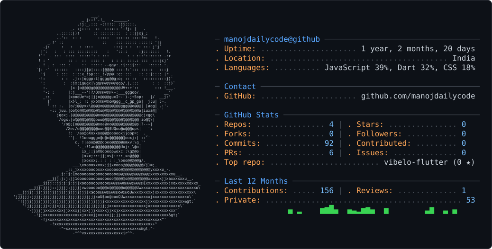

## 👋 Hi, I'm Manoj Kumar

**Aspiring Backend Developer (Python)** from **India 🇮🇳**  
Focused on learning backend development and building strong programming fundamentals.

---

### 🌱 Currently Learning
- Backend development with **Python**
- Web Development: **HTML, CSS, JavaScript**
- Problem solving & clean coding practices

---

### 🛠 Tech Stack
- **Languages:** Python, C  
- **Web:** HTML, CSS, JavaScript  
- **Tools:** Git, GitHub, VS Code, Terminal  

---

### 📂 Practice Projects
- 🎬 **Movie Ultra** — Explore and manage your complete watchlist in one place
- 📓 **Movie Journal Pro** — Personal movie notes & reviews  
- 💰 **Cash Keeper Offline** — Simple offline expense tracker  

> More projects coming as I learn 🚀

---

### 🎯 What I'm Doing Now
- Practicing coding daily
- Building small projects to improve logic
- Learning how backend systems work under the hood

---

### 📫 Contact
- 📧 **Email:** mavillamanoj@gmail.com

---

### 🚀 Motto
**Always learning. Always improving.**
<picture>
  <source media="(prefers-color-scheme: dark)" srcset="dark_mode.svg" />
  <source media="(prefers-color-scheme: light)" srcset="light_mode.svg" />
  
</picture>
